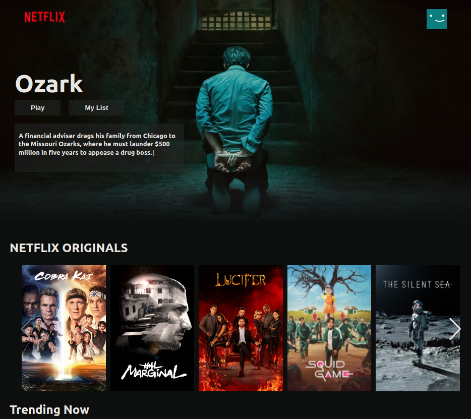
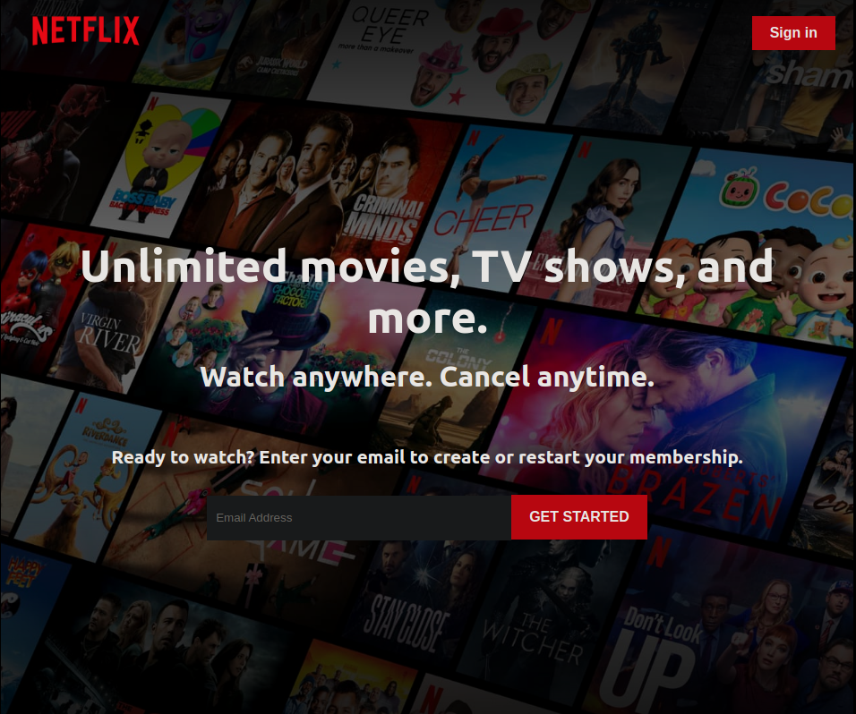
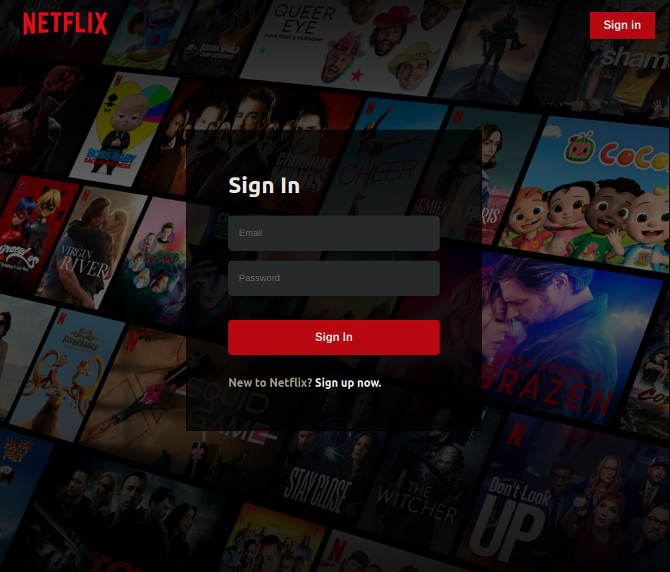
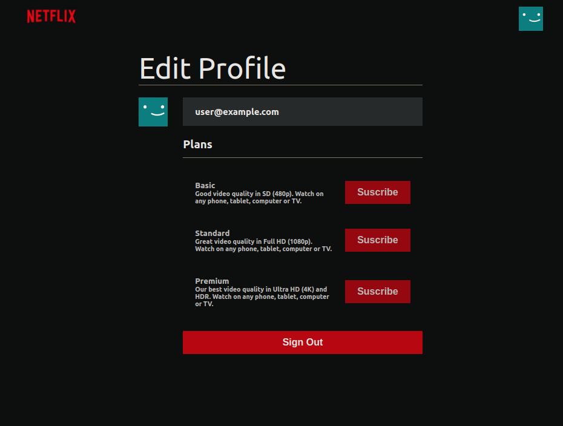
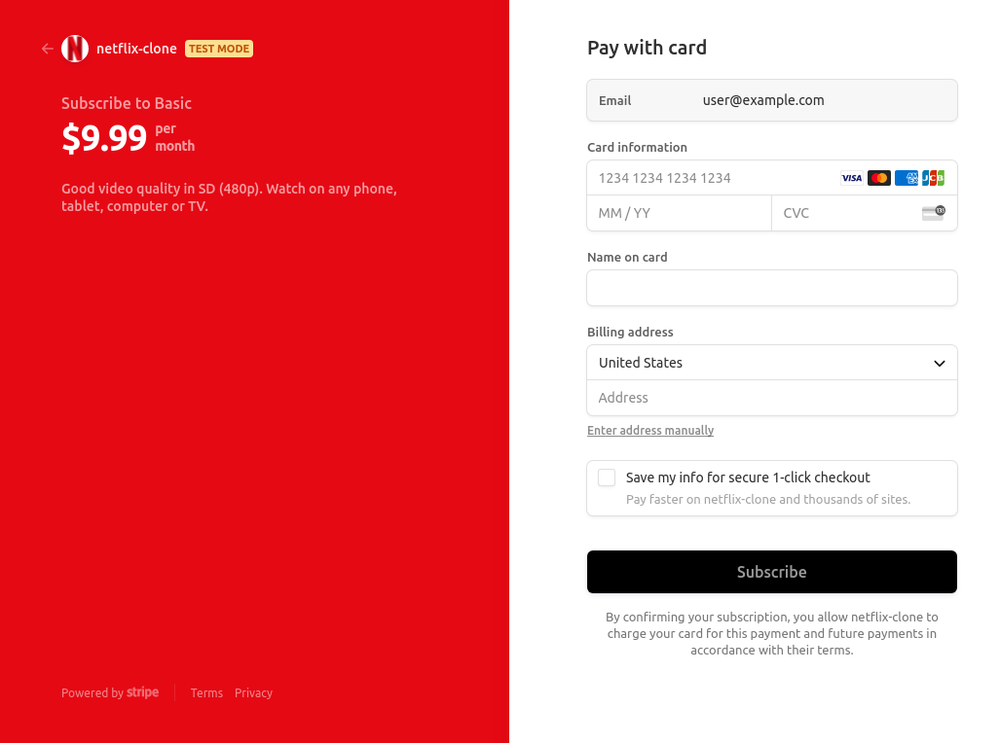

# Netflix Clone

Full-stack application inspired by Netflix. This is a personal project for my software developer portfolio, not for commercial purposes.

[LIVE DEMO](https://netflix-clone-7dcc3.web.app/)

## Tech Stack

- Node.js
- Redux
- React
  - Axios
  - React Router
  - Swiper React
  - React-Toastify
  - Typewriter Effect
- Firebase
  - Hosting
  - Firebase Authentication
  - Firestore Database (NoSQL)
  - Stripe (Firebase extension)

## Implementation Highlights

- This project was bootstrapped with Create React App, using the Redux Toolkit template.

- BEM naming convention for classes in HTML and CSS.

- Responsive web design

- Movie details are pulled from TMDB using their [API](https://developers.themoviedb.org/3/getting-started/introduction 'TMDB API').

- It features a Sign up and Sign in page that can be tested using the credentials below or entering your own.

  - Email: user@example.com
  - PW: 123456

- Implemented subscription payments with Stripe Checkout. Currently in test mode to show the functionality, no payments are actually made. It can be tested with the details below:

  - Card #: 4242 4242 4242 4242
  - CVC: Any 3 digits
  - Date: Any future date
  - Billing address, enter dummy details

<br />

## Running Locally

Requires Node 22.

1. `cp .env.example .env.local` and fill in your Firebase web app config and TMDB API key.
2. `npm ci`
3. `npm run dev` for a local server, `npm test`, `npm run lint`, and `npm run build` for a production build in `build/`.

Deploying with Firebase Hosting needs a `firebase.json` (kept out of git) that serves `build/`
and rewrites every path to `index.html`, so links like `/profile` work on refresh:

```json
{
  "hosting": {
    "public": "build",
    "ignore": ["firebase.json", "**/.*", "**/node_modules/**"],
    "rewrites": [{ "source": "**", "destination": "/index.html" }]
  }
}
```

## Screenshots

HomeScreen:


<br />

LoginScreen:


<br />

SignUpcreen:


<br />

ProfileScreen:


<br />

Stripe Checkout:


## Disclaimer

This application features materials protected by the Fair Use guidelines of Section 107 of the Copyright Act. All rights reserved to the copyright owners.
